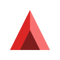

<p align="center"></p>

<h1 align="center">Tangra</h1>

<p align="center">An open-source design tool: an infinite canvas for frames, shapes, screenshots and notes.</p>

> **Work in progress.** This is an early version; expect rough edges and breaking changes.

## Features

- **Infinite canvas** with smooth pan and zoom (Shift+0 for 100%, Shift+1 to fit)
- **Frames** that nest: an object belongs to the frame that fully contains it
- **Outline panel** showing the layer tree of the frame you're working in (`L` to collapse)
- **Shapes and drawing:** rectangle, ellipse, arrow, pen, highlighter, blur, text, eraser
- **Images and screenshots:** paste or drop them in, then annotate
- **Notes and link cards**
- **Smart snapping:** alignment guides, equal-gap snapping, Alt to measure distances
- **Style bar** for fill, stroke, corner radius and more on the selected object
- **Multiple boards** as tabs, with background autosave
- **Themes, accent colours, background patterns** and adjustable animation strength
- System tray icon, a global hotkey, and single-instance behaviour (Windows)

## Install and run

Tangra currently targets **Windows**. You need [Rust](https://rustup.rs) (stable).

```bash
git clone https://github.com/zybher/tangra.git
cd tangra/native
cargo build --release
```

Then run `native/target/release/tangra.exe`, or use `cargo run --release` from `native/`.

Boards are saved in `%APPDATA%\com.tangra.app`.

## Where things live

All source is in `native/src/`. Most features live in one file; start from the table below.

| Area | File | What's in it |
| --- | --- | --- |
| **Startup & app loop** | `main.rs` | `App` struct and fields, `App::new`, the per-frame `update` loop, egui style setup, `main()`; shared enums (`Kind`, `Tool`, `Drag`, `Act`, `Prompt`), `View` (screen↔world), toolbar icons, stroke painting |
| **Data model** | `model.rs` | Board, images, notes, links, frames (`Group`), strokes, labels, `Settings` (saved to disk) |
| **Windows / OS** | `platform.rs` | Win32 calls, tray icon, global hotkeys, clipboard, image load/save (PNG/JPEG/WebP/GIF/BMP/TIFF/ICO), cursor position for drops |
| **Colours & canvas looks** | `theme.rs` | Canvas themes, accent colour (`blue()`), surface tones (`frame_bg()` for bars, `popup()` for things that open), gradients, Aurora palettes/motion, background patterns |
| **Shared animation helpers** | `widgets.rs` | `spring`, `ease`, `hover_fx`, `wave_rows`/`wave_tile` (magnify lists), `liquid_fill`, `roll_text` (rolling digits), smooth zoom text, `zoom_text` (sharp text on magnified bar segments), hand cursor, active-tab shape |
| **Actions** | `app/actions.rs` | `apply`: every menu, toolbar and shortcut action (`Act`) is handled here |
| **Clipboard & drops** | `app/clipboard.rs` | Copy/paste objects and images, drag-and-drop files from Explorer, duplicate |
| **Background autosave** | `app/saver.rs` | Writes boards on a worker thread (newest copy per board), flushed before hide/quit |
| **Undo & selection state** | `app/state.rs` | Undo/redo, saving, select/deselect, label editing bookkeeping |
| **Board operations** | `app/board_ops.rs` | Delete, bring to front / send to back, text editing commit, eraser, switch board, zoom-to-fit, hide/quit |
| **Input** | `canvas/input.rs` | Keyboard shortcuts, pointer drags (move, resize, draw, marquee), input routing |
| **Drawing the board** | `canvas/paint.rs` | Background, items (only pictures straight on the board cast a shadow, none inside a frame or with cut-outs), annotations, hover/selection outlines, multi-select box, marquee |
| **Size numbers** | `canvas/size_pills.rs` | Width/height pills around the selection (glide, merge, rolling digits) |
| **Smart move & measuring** | `canvas/snap.rs` | Snapping to other on-screen objects' edges/centres with red guide lines (closest wins), equal-gap spacing in rows/columns, size matching while resizing, Shift axis lock, Ctrl to move freely, Alt-hover gap/edge measurement, Alt-drag duplicate distance to the original with round-number gap snapping (100/50/10) |
| **Bulk spacing handles** | `canvas/gap_handles.rs` | When a selection is an evenly spaced row/column, a handle sits in each gap; dragging one changes every gap at once, Shift-drag changes just that gap (frames bring their contents) |
| **Multi-select editing** | `canvas/multi_edit.rs` | Resize a multi-selection from its box (everything scales, frames bring contents), arrow-key nudge (Shift: 10 px) |
| **Hit-testing** | `canvas/hit_test.rs` | Item rects, what's under the pointer, items in a marquee; a selected drawing grabs anywhere inside its box; the marquee picks a line or outline only when it touches the line itself (filled shapes by area) |
| **Geometry** | `canvas/geometry.rs` | Pure math helpers: rect/segment tests, stroke hits, shape constraints; rectangles / ellipses draw as one closed line (never pen-smoothed); line widths have no screen-pixel floor, so everything keeps its size relative to the board at any zoom (only frame titles stay one screen size) |
| **Pen stroke mesh** | `canvas/stroke_mesh.rs` | Pen / highlighter lines as one smooth mesh: thinned + Chaikin-rounded points, round caps, 1px soft edge (no square cuts at zoom, no dark end dots when see-through); hovering a drawing traces its line instead of a box |
| **Image names** | `image_names.rs` | Pasted / screenshotted pictures are named Image 1, Image 2, ... (next number after the highest); a dropped file keeps its own name unless it is a random id; older boards name their id-named pictures on load |
| **Image edits** | `image_edit.rs` | Per-picture colour adjust (brightness, contrast, saturation, hue, warmth), lasso cut-outs and 3D tilt settings; edited copy rebuilt on the CPU when they change |
| **Picture sliders** | `ui/image_sliders.rs` | The Adjust / 3D dropdowns, opening under (or over) the placement bar from their buttons: wave list with a narrower wave (`wave_rows_k`: the hovered row rises fully, neighbours less), rows scrub sideways (double-click resets) and the dragged row holds the wave alone until let go, reset row at the bottom, Restore cut areas when a picture has cuts |
| **3D tilt** | `canvas/tilt3d.rs` | Tilt / turn / spin a picture in 3D with perspective depth, drawn as a 16×16 grid mesh; strokes on it follow the tilt; maps points back for the lasso |
| **Lasso cut** | `canvas/lasso.rs` | Lasso tool (K): drag a loop, Delete cuts it out of the pictures under it (selected ones first), Esc drops it; marching-ants outline |
| **Textures** | `canvas/textures.rs` | Uploading images to the GPU, pixelate/mosaic, lazy loading |
| **Title bar & tabs** | `ui/titlebar.rs` | Tabs, board switching, window buttons |
| **Bottom toolbar** | `ui/toolbar.rs` | Tool buttons with magnify, zoom/undo pill |
| **Tool option menus** | `ui/tool_menu.rs` | Per-tool menus (pen colours, shapes, sizes…); closes on click-out, Esc, or when the pointer moves well away |
| **Frame style bar** | `ui/style_bar.rs` | Floating bar above a selected frame/shape (or several frames at once): colour, corner radius, border, layout/aspect dropdowns; inside a frame it also gets an Align dropdown (incl. even spacing for 3+) and an opacity scrub, so there's one bar. Opacity shows on every frame (hovered, it fills with accent liquid up to its value); Stroke has an inside/centre/outside dropdown; Arrange only shows for frames with no frames inside; scrolling back on screen (or closing a right-click menu) replays the entrance; the on-screen check uses the resting width (not the hover swell), so it never flickers at the screen edge |
| **Colour picker** | `ui/color_picker.rs` | Custom colour panel (saturation/brightness square, hue slider, hex field) used by the style bar's Custom colour |
| `native/src/ui/scale.rs` | Responsive UI size: scales all chrome with the window width (1:1 on the small default window, up to 1.45x when maximised on big screens) |
| **Canvas panel** | `ui/side_panel.rs` | Theme, accent, gradient, Aurora, patterns, animation strength, settings |
| **Outline panel** | `ui/outline.rs` | Layer tree of the frame you are in (or whole board), search with kind synonyms (photo, sticky, ...), collapses by morphing into a logo tab at the same corner (and grows back out of it), fold, click to select, hover to highlight; pushes the bottom-left HUD aside; `L` toggles; double-click/Enter renames; duplicates get numbered; dragging a row near the top/bottom edge scrolls the list, slow just inside the edge and faster the further past it the cursor goes |
| **Properties** | `ui/props.rs` | Lower part of the outline panel: only what the selection can change (position/size, align, opacity/corners, fill, stroke, text size, picture adjust and 3D). Fields scrub sideways or take a typed value on click; the divider drags to share height with the layers (remembered); folds away with nothing selected and springs up with the bars' jelly |
| **Outline drag & drop** | `ui/outline_drag.rs` | Drag rows to reorder (saved per object) or drop on a frame to move the object into it |
| **Frame nesting** | `canvas/nesting.rs` | Which frame each object belongs to (stored, not guessed from position); the cursor decides which frame a dragged object joins (target frame lights up; hold Ctrl to skip); frames clip their contents at the inner edge of their stroke (strokes are world-sized, they zoom with the frame; only titles stay one screen size) (the cropped-off part of an object is not clickable); nested frames paint and hit-test after their parent |
| **Typing names** | `ui/inline_text.rs` | Renaming in the outline, a frame's title and editing canvas text, in the same style as typing numbers: no text box, an accent ring eases in, the name starts selected, the caret breathes and glides; arrows, Home/End, Shift/Ctrl, Ctrl+A/C/X/V, click or drag to place the caret |
| **App pointer** | `ui/cursor.rs` | The plain arrow is the icon pack's cursor, painted at the pointer (white with a dark edge), following it with a ~25 ms glide and leaning into sideways movement around its tip, with a faint fading trail behind it (tunables at the top of the file); other cursors stay native, and the Space pan hand is the pack's hand (`widgets.rs`) |
| **Typing numbers** | `ui/num_edit.rs` | Double-click any number on the style bar, placement bar or picture dropdowns to type it: an accent ring eases in, the digits start selected, a soft caret breathes at their end. Enter or clicking away sets it, Esc puts it back, Up/Down nudge (Shift = 10); the value then morphs to the new one |
| **Reset morph** | `ui/reset_morph.rs` | "Reset adjustments" / "Reset 3D" in the picture dropdowns ease the values back to zero with the typed-number tween instead of snapping (one undo step; grabbing a row stops it) |
| **Bar dropdown motion** | `ui/drop_anim.rs` | Shared by the style bar and placement bar dropdowns, same as the toolbar right-click menu: one panel per bar that fades and slides in, rows cascade from the bar edge, and switching dropdowns glides and resizes the panel while the new rows cascade in; closing plays it backwards. Same size and timing too: 190 px wide, 30 px rows, centred over its button 14 px off the bar, same glide and cascade speed |
| **Placement bar** | `ui/place_bar.rs` | Pops up when the selection is inside a frame: an Align dropdown (left/centre/right/top/middle/bottom, even spacing for 3+; `ui/place_align.rs`), opacity scrub with the liquid fill, corner radius for a picture; values zoom on the scaled layer so they grow smoothly; steps aside while the style bar is up (that bar carries align + opacity), otherwise sits above the object. A picture outside any frame gets a short opacity + corners bar. A picture also gets Adjust and 3D buttons after a divider (dropdowns in `ui/image_sliders.rs`). Keys: 0-9 opacity, Alt+A/D/W/S/H/V align, Shift+Enter selects the frame; closes with the same domino exit as the style bar (both replay the controls they had, so nothing jumps on close); hides (with its exit) once it can no longer sit over its object on screen, same rule as the style bar (judged on its resting width, remembered while hidden, so it never flickers at the screen edge) |
| **Bar morph** | `ui/bar_morph.rs` | Style bar ↔ placement bar hand-off: the new bar starts where the old one was and glides instead of popping out/in |
| **Frame-first picking** | `canvas/scope_pick.rs` | A click inside a frame picks the frame; double-click steps one level in, Ctrl+click picks the deepest object, Shift adds |
| **Align & opacity** | `canvas/align.rs` | Align / distribute (row by row on grids) / fill / fit / opacity operations, Ctrl+F (or Ctrl+Alt+G) wraps the selection in a new frame (no fill, square corners; toast names the kind: "Framed 3 images", "objects" when mixed); pressing an align again on objects already lined up moves them as a block to that edge of their frame; opacity is stored per object (`board.opacity`) and a frame fades what's inside it (not its title) |
| **Glides** | `canvas/glide.rs` | Align, distribute, fill/fit and resize-to-fit ease objects into place instead of snapping |
| **Rounded clipping** | `canvas/round_clip.rs` | Images and nested frames inside a rounded clipping frame are cut to its rounded corners (convex polygon clip, textured mesh) |
| **Icon pack** | `ui/svg_icons.rs` | The app's 138 line icons (24-unit SVG, one style) and a small drawer: each SVG is parsed once into polylines and painted as vector strokes (fills, stroke widths, dashes), so icons stay sharp at any size and in the magnify; used by the toolbar tools, outline rows, bars and dropdowns |
| **Line icons** | `ui/icons.rs` | Named helpers (eye, lock, align, distribute, opacity, adjust, 3D, per-kind outline glyphs) that draw from the icon pack |
| **Hide / lock** | `canvas/visibility.rs` | Hidden objects skip painting; hidden or locked ones skip picking; a frame passes its state to everything inside |
| **App icon** | `native/build.rs`, `native/assets/icon.ico` | Embeds the icon into `tangra.exe` at build time (regenerate the .ico from `icon128.png`) |
| **Right-click menu** | `ui/menus.rs` | Context menu contents |
| **Menu building blocks** | `ui/menu_kit.rs` | Menu open/close animation, rows, radios, checks, swatches, dividers |
| **Dialogs** | `ui/dialogs.rs` | Label editing, board name prompts, hotkey recording |
| **Shortcuts overlay** | `ui/shortcuts.rs` | The shortcut list in the corner |

### Conventions

- Feature code is an `impl App { … }` block in its own file; each file starts with `use crate::*;`.
- Short-lived UI state (hover, animation, "is this open") is kept in egui temp data under keys
  starting with `qd_`, e.g. `egui::Id::new("qd_style_bar").with("pop")`. Some keys are shared
  between files (the size pills read the style bar's `scrub`/`pop` state), so search for the key
  before renaming one.
- Colours always come from `theme.rs` helpers, never hard-coded, so themes and accents apply everywhere.

## License

MIT. See [LICENSE](LICENSE).
